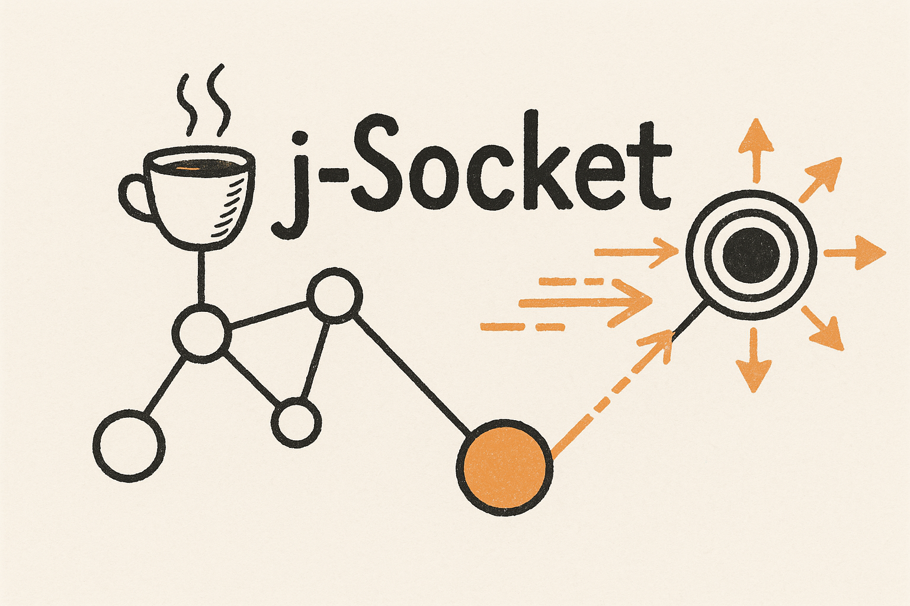

# JSocket 🚀

[](https://opensource.org/licenses/MIT)
[](https://www.java.com)

#### A lightweight, easy-to-understand Java WebSocket server for real-time applications

[](https://github.com/AceAtDev/JSocket--java-simple-websocket/blob/main/docs/media/chess-demo.mp4)

*Two separate browser sessions play the first six moves of a chess game; each move goes through the JSocket server and appears on the other board right away. Click for the full-quality MP4.*



JSocket provides a simple WebSocket implementation in Java with no external dependencies. It is useful for learning WebSocket internals, building custom real-time features, or adding WebSocket support to existing Java applications.

## ✨ Features

- **Beginner-friendly** code structure with extensive documentation
- **RFC 6455 compliant** WebSocket implementation
- **Concurrent client handling** with dedicated reader/writer threads
- **Event-driven architecture** via simple listener interface
- **Working Chess game demo** showcasing real-time capabilities
- **Zero external dependencies**: only the Java standard library

## 🚀 Quick Start

### Run the demo

Requires a JDK (8 or newer). From a terminal:

```bash
git clone https://github.com/AceAtDev/JSocket--java-simple-websocket
cd JSocket--java-simple-websocket

# Compile everything into out/
javac -d out $(find javaWebsocketChess -name "*.java")

# Start the chess server (default port 8080; pass another port as an argument)
java -cp out javaWebsocketChess.chess.ChessServerMain
```

Then open `javaWebsocketChess/chess/clientApp/index.html` in two browser tabs or windows. The first one to connect plays White, the second plays Black. If you started the server on a different port, add it to the page URL, for example `index.html?port=8765`.

The GIF above was recorded with [`docs/demo/record_demo.py`](docs/demo/record_demo.py). It compiles and starts the server, plays six moves in two Playwright browser sessions, and builds the MP4 and GIF with ffmpeg:

```bash
pip install playwright && playwright install chromium
python docs/demo/record_demo.py            # or: --port 8765 if 8080 is busy
```

### Use JSocket in Your Project

1️⃣ **Copy the core files** from `javaWebsocketChess/websocketCore/` into your project (the classes use the package `javaWebsocketChess.websocketCore.src.main.java.com.jSocket.websocket`, so keep that folder layout or update the `package` and `import` lines)

2️⃣ **Create your handler:**

```java
public class MyWebSocketHandler implements WebSocketListener {
    @Override
    public void onOpen(ClientHandler connection) {
        connection.sendMessage("Welcome!");
    }

    @Override
    public void onMessage(ClientHandler connection, String message) {
        System.out.println("Received: " + message);
        connection.sendMessage("You said: " + message);
    }

    @Override
    public void onClose(ClientHandler connection, int code, String reason, boolean remote) {
        System.out.println("Connection closed: " + reason);
    }

    @Override
    public void onError(ClientHandler connection, Exception ex) {
        ex.printStackTrace();
    }
}
```

3️⃣ **Start the server:**

```java
public static void main(String[] args) {
    WebSocketServer server = new WebSocketServer(8888, new MyWebSocketHandler());
    try {
        server.start();
        System.out.println("WebSocket server running on port 8888");
    } catch (IOException e) {
        e.printStackTrace();
    }
}
```

## 🧩 Key Components

JSocket has five main parts:

- **`WebSocketServer`**: Manages TCP connections and handshakes
- **`ClientHandler`**: Manages WebSocket connection lifecycle
- **`WebSocketDataReader/Writer`**: Handle frame reading/writing
- **`WebSocketFrame`**: Represents WebSocket protocol frames
- **`WebSocketListener`**: Interface for your application logic

## 🔍 Use Cases

- **Learning WebSocket internals** without complex dependencies
- **Real-time chat applications**
- **Multiplayer games** (like the included Chess demo)
- **Live dashboards and monitoring tools**
- **Adding WebSocket capability** to existing Java applications

## 📚 Documentation

For more detailed information:

- **[how it works](docs/HowItWorks.md)** - Detailed description of classes and methods

## 🤝 Contributing

Contributions are welcome! Whether it's bug reports, feature requests, or code contributions:

- Fork the repository
- Create your feature branch: `git checkout -b feature/amazing-feature`
- Commit your changes: `git commit -m 'Add some amazing feature'`
- Push to the branch: `git push origin feature/amazing-feature`
- Open a Pull Request

## 📄 License

JSocket is [MIT licensed](LICENSE).

---

#### Developed with ❤️ for the craft of developing

[Report Bug](https://github.com/AceAtDev/JSocket--java-simple-websocket/issues) •
[Request Feature](https://github.com/AceAtDev/JSocket--java-simple-websocket/issues)

---

## 🙏 Acknowledgements

Special thanks to the amazing [python-websockets/websockets](https://github.com/python-websockets/websockets) project for their wonderful documentation, which was invaluable in creating this repository.
